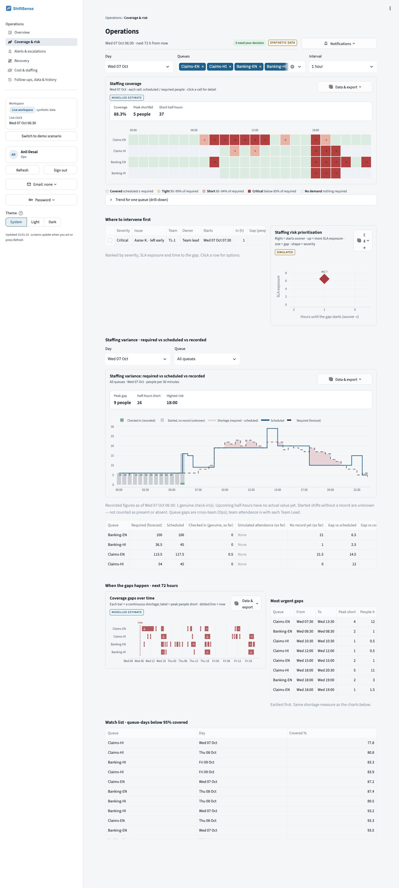
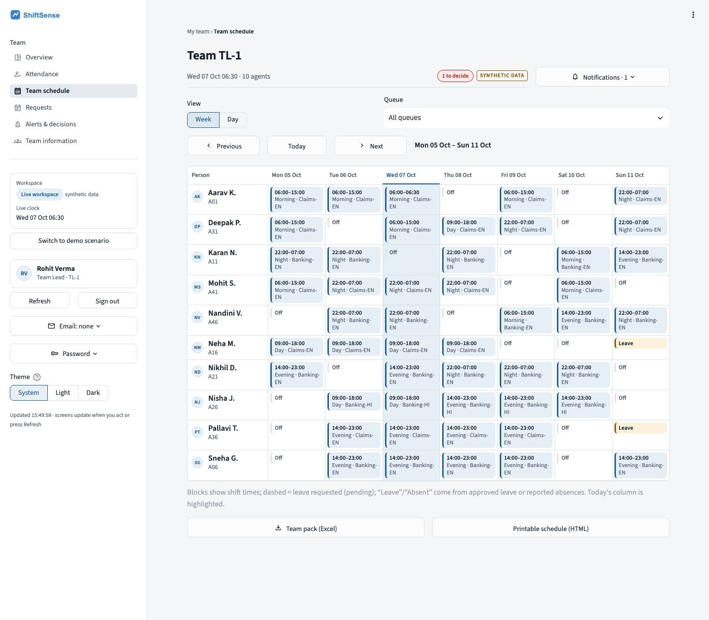
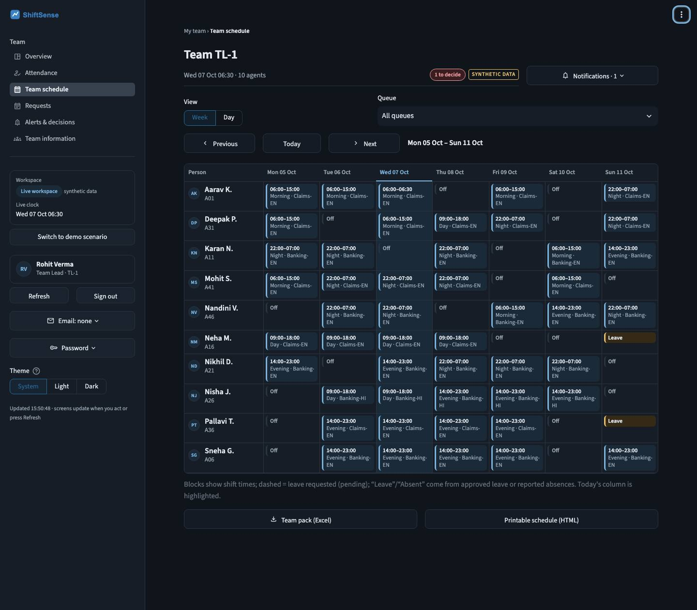
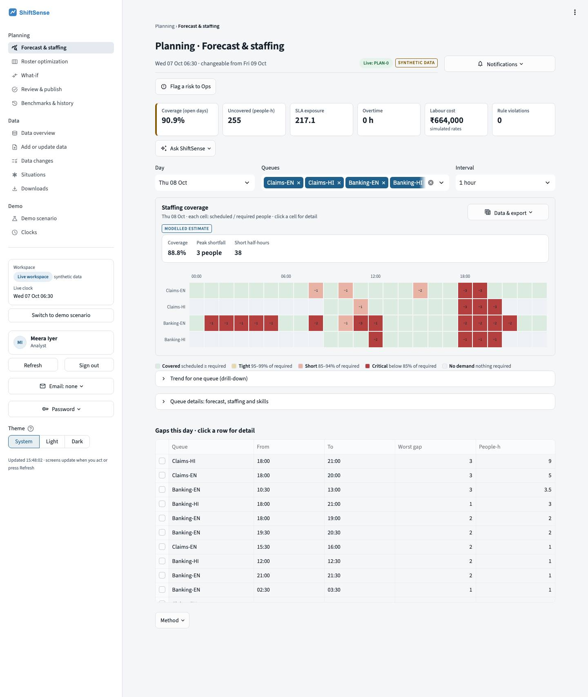
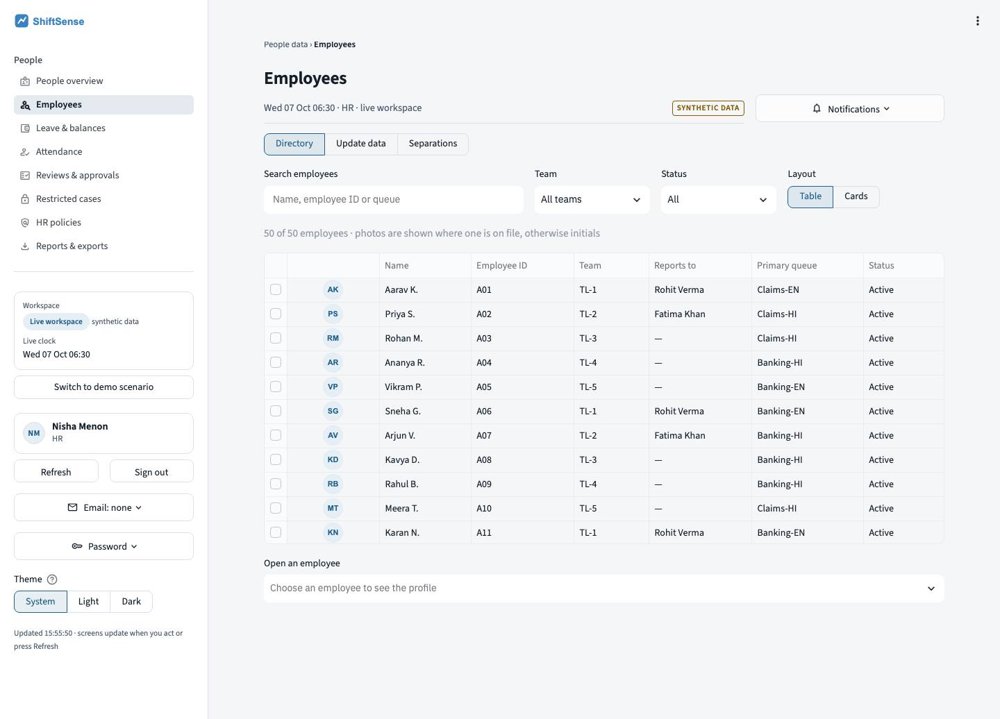

# ShiftSense

**A workforce-operations decision layer for SLA-driven contact centres.** ShiftSense forecasts demand, builds the
roster with a constraint solver, detects coverage gaps as they appear, and recommends the least-disruptive fix,
with a human approving every decision.

*EXL × IIM Lucknow Live Action Project, Group 24: Saswata Saha and Supratik Sarkar · October 2026*

> All data is synthetic (seeded generator). Figures labelled *Simulated* or *Modelled estimate* are not measured
> results.



## The question it answers

Can a decision layer build a better workforce plan, and restore coverage faster and more cheaply than a credible
manual process, without ever breaking a hard workforce rule?

**Loop:** Predict → Plan → Execute → Detect → Recover → Learn

| Step | How |
|---|---|
| Predict | Seasonal forecast per queue and 30-minute slot, with an uncertainty band |
| Plan | Erlang C gives the required people; an OR-Tools CP-SAT optimiser builds the roster under every hard rule |
| Detect | Absences, no-shows and volume spikes become per-queue gaps with a risk score |
| Recover | Candidate fixes (cross-skill redeployment, swap, open shift, overtime) are filtered, simulated and ranked; a team lead approves, modifies or rejects |
| Learn | Every decision and its reason goes into an append-only, hash-chained audit trail |

## Results (simulated, seed 42)

| Hypothesis | Result | Measured |
|---|---|---|
| H1 Planning effort falls ≥ 70 % | Pass | 92 % less (modelled); coverage 90.9 % vs 75.4 % |
| H2 Under-covered workload falls ≥ 20 % at equal paid hours | Pass | 24.6 % → 9.1 % |
| H3 Median time to cover < 10 min | Pass | 7.0 min vs 58 min manual (modelled) |
| H4 Equal coverage at lower cost than overtime-first | Pass | ₹4,950 vs ₹9,500 median, cheaper in 8 of 8 |
| H5 Zero hard-rule violations | Pass | 0 across 3 plans, 1 re-plan and 32 recoveries |

## Features

- **Six roles, each with its own screens:** Agent, Team Lead, Ops, Analyst, HR and Admin. Every permission is
  enforced on the server, and nobody can approve their own request.
- **Planning:** forecast, Erlang C staffing, CP-SAT optimisation with fairness and stability, what-if scenarios,
  validate → publish → roll back.
- **Recovery:** ranked fixes that close the gap with minimum change; residual risk is escalated to Ops, never
  silently accepted.
- **People processes:** leave with Green/Amber/Red coverage checks, swaps, check-in, attendance corrections,
  separations, leave balances, restricted HR cases and versioned HR policy.
- **Data:** imports from Excel, CSV, pasted or typed text, with validation and approval; versioned reference data
  with effective dates.
- **UI:** coverage matrix, calendar views, light and dark themes, profile photos with an initials fallback,
  accessible names and labels.
- **Operations:** SQLite or PostgreSQL 16, verified backups and restore drills, health checks, Docker Compose with
  HTTPS, optional single sign-on (OIDC) and email.
- **AI is optional and never decides.** Rules run first; AI is used only for reading free text or matching import
  columns.

## Tech stack

Python · Streamlit · Google OR-Tools (CP-SAT) · pandas / NumPy · Plotly · SQLite / PostgreSQL · Docker · pytest

## Screenshots

| | |
|---|---|
|  |  |
|  |  |

More in [`evidence/screenshots/`](evidence/screenshots/).

## Run it

```bash
cd application
python3 -m venv .venv && .venv/bin/pip install -r requirements.txt
.venv/bin/python -m streamlit run app.py
```

Open http://localhost:8501. The sign-in screen lists demo accounts (`analyst`, `tl1`, `ops`, `hr`, `admin`,
`aarav`, …). Their passwords are public for demonstration only.

Tests: `cd application && .venv/bin/pytest -q` runs 769 tests. Results: 767 passed on SQLite and 768 passed on
PostgreSQL 16 (the skips are database-specific). Docker deployment: see
[document 04](documentation/04-Installation-Deployment-and-Operations.pdf).

## Repository

```
application/      runnable app: app.py + views/ (screens), shiftsense/ (server actions, optimiser, data layer),
                  tests/, scripts/, database-migrations/, Dockerfile, docker-compose.yml
documentation/    six PDF guides (+ Markdown sources), workflows, data dictionary, ERD, permission matrix,
                  state tables, test catalogue, requirements traceability
templates/        import templates and instructions
evidence/         screenshots, test results, accessibility checks, H1–H5 evidence, acceptance checklist
operations/       backup and restore, monitoring, troubleshooting, incident response
```

| Document | |
|---|---|
| [01 Project and User Guide](documentation/01-Project-and-User-Guide.pdf) | what it does, every role's screens |
| [02 Workflows and Business Rules](documentation/02-Workflows-and-Business-Rules.pdf) | every workflow and rule |
| [03 Technical Architecture and Data](documentation/03-Technical-Architecture-and-Data.pdf) | design, planning engine, data model |
| [04 Installation, Deployment and Operations](documentation/04-Installation-Deployment-and-Operations.pdf) | local, Docker, backups |
| [05 Security, Administration and Integrations](documentation/05-Security-Administration-and-Integrations.pdf) | security model, SSO, email |
| [06 Testing, Acceptance and Pilot Readiness](documentation/06-Testing-Acceptance-and-Pilot-Readiness.pdf) | tests, evidence, limitations |

## Status and limits

A proof of concept on synthetic data. It is demonstration-ready and verified by tests. A real pilot would also need
hosting, an identity provider, an email relay, real data and validated cost assumptions. See
[known issues and limitations](documentation/supporting/testing/known-issues-and-limitations.md).

## Authors

Saswata Saha and Supratik Sarkar, IIM Lucknow, for the EXL × IIM Lucknow Live Action Project.
