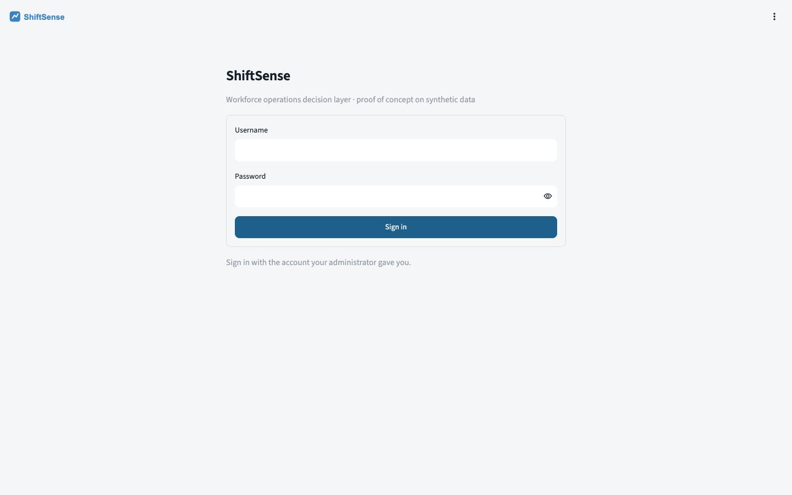
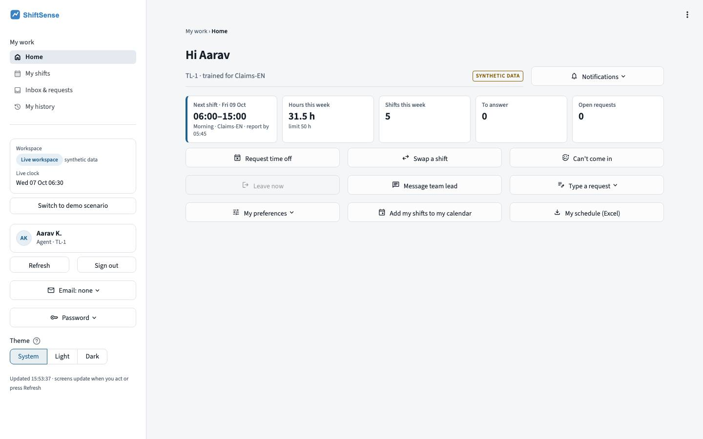

# ShiftSense — Project and User Guide

*EXL × IIM Lucknow Live Action Project · Group 24 (Saswata Saha, Supratik Sarkar) · October 2026*

> All data in ShiftSense is synthetic (seeded generator). Figures labelled *Simulated* or *Modelled estimate* are not
> measured results.

## 1. What ShiftSense is

ShiftSense is a workforce-operations **decision layer** for SLA-driven BPO contact centres. It continuously compares
demand with the skilled capacity that is available, detects coverage risk, and recommends the least-disruptive
feasible action to restore service within cost and policy limits. Around that loop it runs the people processes a
contact centre needs: leave, swaps, attendance, HR records and governance.

**The question the PoC answers:** can ShiftSense create a better workforce plan, and restore coverage faster and at
lower incremental cost than a credible manual process, without breaking hard workforce rules?

**Loop:** Predict → Plan → Execute → Detect → Recover → Learn.

| Step | What happens |
|---|---|
| Predict | Seasonal forecast of calls per queue and 30-minute slot, with an uncertainty band (no ML) |
| Plan | Erlang C converts the forecast into required people; a CP-SAT optimiser builds the roster under every hard rule |
| Execute | The Analyst validates and publishes the roster; agents see their shifts and check in |
| Detect | Absences, no-shows and volume spikes open a gap per queue; risk is scored (Critical / At risk / Healthy) |
| Recover | Candidate fixes are generated, filtered on hard rules, simulated and ranked; a team lead approves, modifies or rejects |
| Learn | Every decision and reason is logged; KPIs and the evidence table compare approaches |

## 2. Results on the synthetic data (simulated)

| Hypothesis | Result | Measured (simulated) |
|---|---|---|
| H1 Planning effort falls ≥ 70 % | **Pass** | 92 % less effort (400 → 30 min, modelled); coverage 90.9 % vs 75.4 % |
| H2 Under-covered workload falls ≥ 20 % at equal or lower paid hours | **Pass** | 24.6 % → 9.1 % at the same 3,824 paid hours |
| H3 Median Time-to-Cover < 10 min | **Pass** | 7.0 min (modelled) vs 58 min manual on the same disruptions |
| H4 Equal coverage restored more cheaply than overtime-first | **Pass** | median ₹4,950 vs ₹9,500, cheaper in 8 of 8 scenarios (simulated rates) |
| H5 Zero hard-rule violations | **Pass** | 0 across 3 plans, 1 re-plan and 32 recoveries (independent checker) |

Full ablation: `evidence/test-results/workflow-validation/ablation-simulated.csv`.

## 3. Roles

Six roles. Every permission is checked on the server for every action, and nobody can approve their own request.

| Role | Purpose | Main screens |
|---|---|---|
| **Agent** | See shifts, check in, ask for leave or swaps, report a problem | Home · My shifts · Inbox & requests · My history |
| **Team Lead** | Run their own team: attendance, requests, staffing alerts | Overview · Attendance · Team schedule · Requests · Alerts & decisions · Team information |
| **Ops** | Escalations, coverage and cost decisions, carried risk | Overview · Coverage & risk · Alerts & escalations · Recovery · Cost & staffing · Follow-ups, data & history |
| **Analyst** | Forecast, plan, publish, data, demo scenario | Planning (Forecast & staffing, Roster optimization, What-if, Review & publish, Benchmarks & history) · Data (overview, add/update, changes, situations, downloads) · Demo (scenario, clocks) |
| **HR** | Employees, contracts, leave, balances, attendance corrections, HR cases, HR policy | People overview · Employees · Leave & balances · Attendance · Reviews & approvals · Restricted cases · HR policies · Reports & exports |
| **Admin** | Oversight only: accounts, governance, audit, system status (no operational decisions) | Overview · Accounts & access · Governance & decisions · Audit & integrity · System status |

## 4. Getting started

1. Open the address you were given and sign in (username and password, or **Sign in with your company account**
   when single sign-on is configured).
2. The left sidebar shows your role's screens, the workspace (Live, or the clearly marked Demo scenario), your name,
   **Refresh**, **Sign out**, email settings, **Password** and **Theme** (System / Light / Dark).
3. Screens do not refresh by themselves: press **Refresh** to see changes made by others.
4. Every screen carries a breadcrumb, a **Synthetic data** badge and a **Notifications** menu.

## 5. Using ShiftSense by role

### 5.1 Agent
- **Home:** today's shift, the check-in button when the window is open (30 min before to 1 h after the start), and
  anything waiting for you.
- **My shifts:** a week calendar of your shifts with their record status; a timeline view is available.
- **Inbox & requests:** ask for time off (form or plain text such as "sick leave on Friday"), ask a trained colleague
  to swap, reply to cover offers, withdraw a pending request. A Red coverage result offers alternatives.
- **My history:** everything recorded about your shifts; *Report a record problem* sends a correction request.

### 5.2 Team Lead
- **Overview:** what needs a decision first.
- **Attendance:** an agenda in time order; a started shift without a record shows *No attendance record* (unknown,
  never assumed absent).
- **Team schedule:** week calendar and day time-grid with a "now" line and gap rows.
- **Requests:** pending requests with the coverage effect, plus a 14-day team leave calendar. Sick-leave details stay
  with HR.
- **Alerts & decisions:** each staffing alert shows the gap, the proposed fix, coverage now vs after the fix, and
  **Approve / Modify / Reject / Escalate**. A reason is required for anything other than approve.

### 5.3 Ops
- **Overview:** exception-first control tower: open alerts, escalations, carried risk, overdue items.
- **Coverage & risk:** staffing coverage matrix (queues × time) for the next 72 h, a gap timeline with the most urgent
  gaps, where to intervene first, and a watch list of queue-days below 95 %.
- **Alerts & escalations:** decide escalations (overtime budget, agency cover, or accept and carry the risk, with a
  reason), or return them to the team lead.
- **Recovery** and **Cost & staffing:** recovery performance and simulated daily cost (labour + overtime).

### 5.4 Analyst
- **Forecast & staffing:** the coverage matrix (Covered / Tight / Short / Critical), filters and an interval detail
  card with the people who could help.
- **Roster optimization:** build a new draft with the CP-SAT optimiser, compare with the live roster and see the gaps.
- **What-if:** try scenarios without touching live.
- **Review & publish:** validate (independent rule check) → confirm → publish; restore an earlier version to roll back.
- **Data:** add or update service levels, rules, volumes and situations; follow data changes from preview to applied.
- **Demo:** load the demo story into a separate scenario and run its simulation clock. **The demo never changes live data.**

### 5.5 HR
- **Employees:** directory (table or cards, with photos or initials), profile with tabs, update data, separations.
- **Leave & balances:** leave calendar, opening balances (verified by a second HR user), ledger and adjustments.
- **Attendance:** correction requests after the 48-hour lock.
- **Reviews & approvals:** leave review tasks (long leave, sick leave, balance problems) and other HR approvals.
- **Restricted cases:** visible only to the assigned caseworker and Senior HR.
- **HR policies:** every HR setting with status and versions, and the retention register.

### 5.6 Admin
- **Overview:** the week's roster and records as a calendar or table.
- **Accounts & access:** create accounts, reset passwords, unlock, deactivate, grant Senior HR (reason required).
- **Governance & decisions:** discrepancy scans and governance cases; the decision log.
- **Audit & integrity:** the hash-chained audit trail, schedule change history and integrity checks.
- **System status:** health, backups and the email relay check.

## 6. Light and dark themes
Choose **Theme → System, Light or Dark** in the sidebar. The choice is saved on your account. Charts, calendars and
dialogs follow the theme. Screenshots of both themes are in `evidence/screenshots/light-mode` and `dark-mode`.

## 7. Good to know
- **Live vs demo:** the demo scenario is a separate copy, marked by a banner on every screen.
- **Truthfulness:** forecasts are labelled as predictions; unknown values say *Unavailable* or *Not configured*.
- **Reasons and audit:** every decision is recorded with who, when and why, and cannot be edited.
