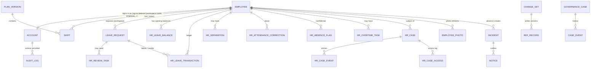

# Entity relationship diagram

Logical relationships between the stored entities. Employees are versioned reference records (`ref_records`, domain `employees`) and the agent table inside the workspace; most HR tables refer to them by `employee_id`. Requests, incidents and the roster live inside the versioned workspace snapshot (`workspace`).

## Tables

| Table | Purpose | Module |
|---|---|---|
| `accounts` | Sign-in accounts, contact, security state, theme | accounts.py |
| `audit_log` | Append-only, hash-chained audit trail | comms.py |
| `case_events` | Governance case history | comms.py |
| `cases` | Governance review cases | comms.py |
| `change_sets` | Data changes: submit, approve, apply | refdata.py / dataflow.py |
| `emails` | Email attempts (masked recipient, status) | mailer.py |
| `employee_photos` | Profile photos (resized, metadata stripped) | photos.py |
| `hr_absence_flags` | Confidential absence-pattern flags | hr.py |
| `hr_attendance_corrections` | Attendance correction requests | hr.py |
| `hr_case_access` | Case access log | hr.py |
| `hr_case_events` | Restricted case entries | hr.py |
| `hr_cases` | Restricted HR cases | hr.py |
| `hr_leave_balances` | Opening leave balances | hr.py |
| `hr_leave_transactions` | Leave ledger | hr.py |
| `hr_overtime_tasks` | Overtime approval tasks | hr.py |
| `hr_policy` | Versioned HR policy settings | hr.py |
| `hr_review_tasks` | Leave review tasks | hr.py |
| `hr_separations` | Separation records | hr.py |
| `import_mappings` | Remembered column mappings for imports | refdata.py |
| `live_roster` | Read-model rows of the live roster | store.py |
| `messages` | Conversation threads | comms.py |
| `notices` | In-app notifications | comms.py |
| `plan_versions` | Read-model rows of plan versions | store.py |
| `ref_records` | Versioned reference data (employees, contracts, rules, leave, volumes, situations) | refdata.py |
| `reminders` | Attendance reminders / check-in windows | attendance.py |
| `scenario_workspace` |  |  |
| `schedule_changes` |  |  |
| `schema_migrations` | Applied migrations | db.py |
| `whatif_runs` | Saved what-if scenarios | whatif_store.py |
| `workspace` | Versioned live and demo workspace snapshots | store.py |

Column-level detail: `data-dictionary.xlsx` (sheet Columns) and `application/database-migrations/`.
