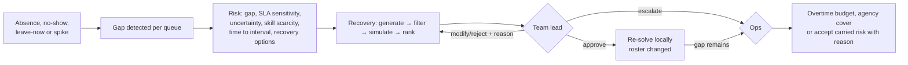

# Workflow: absence and recovery

**Roles:** Agent / Team Lead / Ops report; Team Lead decides; Ops handles escalations.
Implementation: `workflow.report_absence`, `risk.py`, `recovery.py`, `services.decide_incident`.

- **Actions generated:** cross-skill redeployment (the donor queue must stay at or above its own requirement), shift
  swap (partner trained for the same queue), open-shift offer, shift extension / overtime.
- **Filter:** every hard rule, freeze windows, started shifts never touched.
- **Rank:** incremental cost + residual SLA risk + blast radius (people, shifts, queues touched). Minimum necessary change.
- **Residual risk is escalated**, never silently accepted. Ops decisions carry a reason; uncovered hours stay
  visible as carried risk.
- **Overdue:** a critical team-lead alert undecided for `recovery.tl_overdue_hours` (default 2 h) is reported to Ops once.
- The alert card shows coverage now vs after the proposed fix, marked "Proposed · not approved" until approved.
