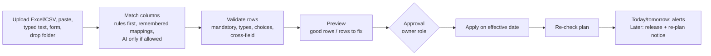

# Workflow: data import and validation

Implementation: `convert.py` (any input), `refdata.py` (versioned records), `dataflow.py` (change engine),
`schemas.py` (field definitions), `dropfolder.py`. Rules: `../data/import-validation-rules.xlsx`.

- **Who owns what.** HR: employees, contracts (Ops approves), leave, balances, photos. Analyst: service levels, rules,
  volumes, situations, base pack. Team-lead proposals go to HR.
- **Never invented.** Mandatory fields missing → the row is held back. Bad rows go to a downloadable rows-to-fix file.
- **AI help** (`SHIFTSENSE_AI_CONVERT`): off or `nonpersonal` by default; personal data is never sent unless
  explicitly allowed. The AI never decides.
- **Drop folder.** `data/inbox/<kind>/`; staged by `scripts/stage_drop_folder.sh <username>`, applied by the app
  on refresh (only the app writes the workspace).
- **Started shifts** are never touched by any import.
- Templates: `templates/employee-import-template.csv`, `templates/call-volume-template.csv`.
